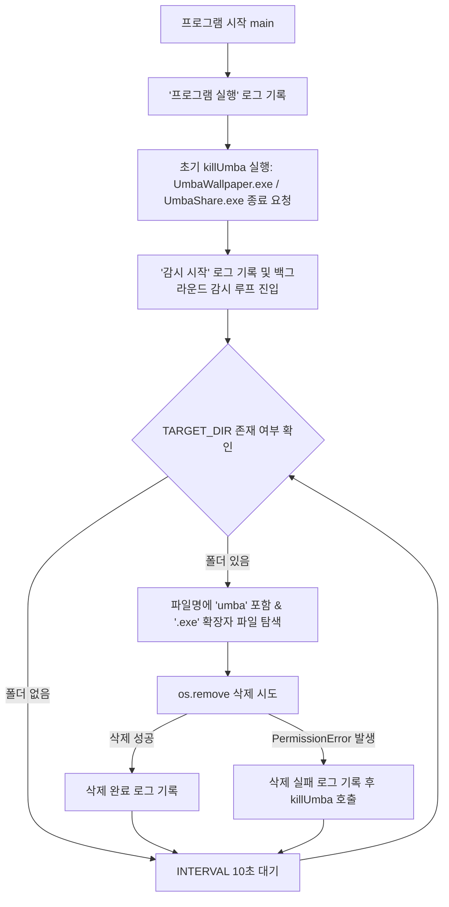

# umbaTerminator

Windows 환경에서 콘솔 창 없이 백그라운드에서 동작하며, **움바(UMBA, 움직이는 바탕화면 프로그램)** 관련 프로세스(`UmbaWallpaper.exe`, `UmbaShare.exe`)를 강제 종료하고 설치 폴더(`%APPDATA%\Umba`) 내의 움바 관련 `.exe` 실행 파일을 10초 주기로 감시·자동 삭제하는 유틸리티입니다.

> 본 문서는 배포 폴더에 함께 동봉된 `README.md` 안내서이자 프로젝트 문서입니다.

---

## 배경 (Background)

**움바(UMBA)** 는 Windows 10/11 환경에서 동작하는 움직이는 배경화면 공유 프로그램([umba.kr](https://umba.kr))입니다.  
그러나 일부 환경에서 다른 프로그램 설치 시 함께 설치되거나, 삭제하려 할 때 다음과 같은 불편이 보고되고 있습니다([SLR클럽 사례](https://m.slrclub.com/v/free/40564143), [네이버 지식iN 사례](https://m.kin.naver.com/qna/dirs/10301/docs/491501030)):

- 백그라운드에서 `UmbaWallpaper.exe`, `UmbaShare.exe` 프로세스가 상주하여 **파일이 사용 중(`PermissionError`)이라 폴더 및 실행 파일 직접 삭제가 차단됨**
- 강제 종료 전에는 폴더 내 실행 파일이 지워지지 않거나 재실행되는 현상 발생

`umbaTerminator`는 실행 즉시 동작 중인 움바 프로세스를 선제적으로 종료하고, 현재 로그인된 사용자의 `%APPDATA%\Umba` 폴더를 **10초 간격**으로 감시하여 이름에 `umba`가 포함된 `.exe` 파일을 백그라운드에서 자동으로 삭제합니다.

---

## 주요 기능

- **무콘솔 백그라운드 실행 (`.pyw` & `--noconsole`)**
  - 화면에 검은색 명령 프롬프트(콘솔) 창을 띄우지 않고 백그라운드에서 조용히 실행됩니다.
- **사용자 환경 자동 인식 (`%APPDATA%\Umba`)**
  - `os.environ["APPDATA"]`를 통해 별도의 경로 설정 없이 현재 로그인한 Windows 사용자의 `C:\Users\<계정명>\AppData\Roaming\Umba` 경로를 자동으로 감시합니다.
- **시작 시 선제적 프로세스 종료 및 10초 주기 감시 (`main`, `killUmba`)**
  - 프로그램이 시작되면 감시 루프 진입 전에 `killUmba()`를 먼저 호출하여 실행 중인 `UmbaWallpaper.exe`, `UmbaShare.exe`에 즉시 종료(`terminate()`)를 요청합니다.
  - 이후 `INTERVAL`(10초) 간격으로 폴더를 확인하며, 파일 삭제 중 `PermissionError`가 발생할 때마다 `killUmba()`를 다시 호출하여 재실행된 프로세스를 종료합니다.
- **움바 관련 실행 파일 선별 삭제 (`deleteUmba`)**
  - `TARGET_DIR` 내의 파일 중 파일명에 `umba`(대소문자 무관, `name.lower()`)가 포함되고 `.exe`로 끝나는 파일만 선별하여 삭제합니다.
- **실행 위치 기준 로그 파일 자동 생성 (`log`)**
  - `getattr(sys, "frozen", False)` 분기를 통해 `umbaTerminator.exe`가 위치한 폴더(`BASE_DIR`)에 `umbaTerminator_YYYYMMDDHHMMSS.log` 파일을 생성하고 모든 작업 내역을 타임스탬프와 함께 기록합니다.

---

## 동작 흐름



---

## 실행 및 종료 방법 (사용자용)

### 1. 프로그램 실행 (`umbaTerminator.exe`)
1. 배포된 `umbaTerminator` 폴더 안에서 **`umbaTerminator.exe`** 를 실행합니다.
   - 프로세스 종료 및 파일 삭제 권한 확보를 위해 **마우스 우클릭 → [관리자 권한으로 실행]** 을 권장합니다.
2. `--noconsole` 옵션으로 빌드되었으므로 실행 시 별도의 창이 나타나지 않으며, 즉시 백그라운드에서 감시가 시작됩니다.
3. 정상 실행 여부는 같은 폴더에 생성되는 **`umbaTerminator_YYYYMMDDHHMMSS.log`** 파일에서 확인할 수 있습니다.

> **주의 (`--onedir` 배포 구조):** `umbaTerminator.exe` 단일 파일만 바탕화면 등으로 복사하면 실행되지 않습니다. 반드시 폴더 전체(`_internal` 등 내부 구성 파일 포함)를 유지한 채 실행하거나, **바로가기(Shortcut)** 를 만들어 사용하세요.

### 2. 프로그램 종료 방법
콘솔 창이 없는 백그라운드 프로세스이므로, 감시를 중단하려면 아래 두 가지 방법 중 하나를 사용합니다.

- **작업 관리자 사용:**
  1. `Ctrl + Shift + Esc`를 눌러 **작업 관리자**를 엽니다.
  2. **세부 정보**(또는 프로세스) 탭에서 **`umbaTerminator.exe`** (또는 `.pyw` 직접 실행 시 `pythonw.exe`)를 찾습니다.
  3. 마우스 우클릭 후 **[작업 끝내기]** 를 클릭합니다.
- **명령 프롬프트(CMD) / PowerShell 사용:**
  ```cmd
  taskkill /F /IM umbaTerminator.exe
  ```

---

## 빌드 및 개발 환경 (개발자용)

### 1. 요구 사항
- **운영체제:** Windows 10 / 11
- **Python:** Python 3.7 이상
- **필수 패키지:** `psutil`, `pyinstaller`

```bash
pip install psutil pyinstaller
```

### 2. 프로젝트 디렉터리 구성 (빌드 전)
```text
project_root/
├── umbaTerminator.pyw
├── README.md
└── images/
    └── icon.ico
```

### 3. PyInstaller 빌드 명령어
소스 파일 확장자를 `.pyw`로 지정한 뒤 아래 명령어로 빌드합니다.

```bash
pyinstaller --noconsole --onedir --icon=images/icon.ico --add-data "README.md;." umbaTerminator.pyw
```

| 옵션 | 설명 |
| :--- | :--- |
| `--noconsole` (`-w`) | 실행 시 표준 콘솔 창을 띄우지 않음 (`.pyw`와 동일하게 백그라운드 동작) |
| `--onedir` (`-D`) | 실행 파일과 의존 라이브러리를 `dist/umbaTerminator/` 하나의 폴더로 패키징 |
| `--icon=images/icon.ico` | 실행 파일(`umbaTerminator.exe`)에 커스텀 아이콘 적용 |
| `--add-data "README.md;."` | 빌드 결과물 폴더 내에 `README.md` 파일을 함께 포함 |

### 4. 빌드 결과물 구조 (`dist/umbaTerminator/`)
```text
dist/umbaTerminator/
├── umbaTerminator.exe                  # 메인 실행 파일 (아이콘 적용됨)
├── umbaTerminator_YYYYMMDDHHMMSS.log   # 실행 시 생성되는 로그 파일
└── _internal/                          # 런타임 의존성 및 동봉된 README.md (PyInstaller 6+ 기준)
    └── README.md
```
*(PyInstaller 5.x 이하 버전에서는 `README.md` 및 의존성 파일들이 `umbaTerminator.exe`와 같은 루트 경로에 위치합니다.)*

### 5. 주요 설정 상수
| 상수명 | 설정값 | 설명 |
| :--- | :--- | :--- |
| `BASE_DIR` | `sys.executable` 또는 `__file__` 기준 경로 | 빌드 여부(`sys.frozen`)를 감지하여 실행 파일 폴더 경로 자동 설정 |
| `LOG_FILE` | `umbaTerminator_YYYYMMDDHHMMSS.log` | `BASE_DIR` 하위에 생성되는 실행 로그 파일 경로 |
| `TARGET_DIR` | `%APPDATA%\Umba` | 감시 및 삭제 대상 폴더 (`C:\Users\<계정명>\AppData\Roaming\Umba`) |
| `INTERVAL` | `10` | 폴더 감시 주기 (10초) |
| `TARGET_PROCESS` | `["UmbaWallpaper.exe", "UmbaShare.exe"]` | 강제 종료할 대상 프로세스 이름 목록 |

---

## 로그 출력 예시

`umbaTerminator.exe`와 동일한 폴더에 `umbaTerminator_20261104150000.log` 형태로 기록됩니다.

```text
[2026-11-04 15:00:00] 프로그램 실행
[2026-11-04 15:00:00] 종료 요청: UmbaWallpaper.exe (PID=14280)
[2026-11-04 15:00:00] 종료 요청: UmbaShare.exe (PID=15104)
[2026-11-04 15:00:00] 총 2개의 대상 프로세스에 종료를 요청했습니다.
[2026-11-04 15:00:00] 감시 시작: C:\Users\User\AppData\Roaming\Umba
[2026-11-04 15:00:00] 삭제 완료: C:\Users\User\AppData\Roaming\Umba\UmbaWallpaper.exe
[2026-11-04 15:00:00] 삭제 완료: C:\Users\User\AppData\Roaming\Umba\UmbaShare.exe
```

---

## 주의 사항 및 참고

1. **`--noconsole` / `.pyw` 환경에서의 `print()` 주의:**
   - `.pyw` 또는 PyInstaller `--noconsole` 환경에서는 표준 출력(`sys.stdout`)이 `None`이 되기 때문에, `log()` 함수 내 `print(line, flush=True)` 실행 시 일부 Python/PyInstaller 버전에서 `AttributeError: 'NoneType' object has no attribute 'write'`(또는 `'flush'`)가 발생할 수 있습니다.
   - 무콘솔 빌드 환경에서 더욱 안전하게 동작하게 하려면 `log()` 함수에서 `if sys.stdout is not None: print(line, flush=True)` 형태로 조건을 추가하거나 `print()` 호출을 제거하는 것을 권장합니다.
2. **권한 문제 (`AccessDenied` / `PermissionError`):**
   - 대상 프로세스가 관리자 권한으로 실행 중일 경우 일반 권한에서는 종료 및 삭제가 거부될 수 있으므로 관리자 권한 실행을 권장합니다.
3. **공식 제거 경로 참고:**
   - 공식 안내([UMBA FAQ](https://umba.kr/?cate=faq))에 따른 기본 제거 경로는 `움바 프로그램 종료 > Windows 설정 > 앱 > 설치된 앱 > 움바 제거`이며, 본 프로그램은 일반 제거가 되지 않거나 반복 생성되는 잔여 실행 파일을 처리할 때 유용합니다.
